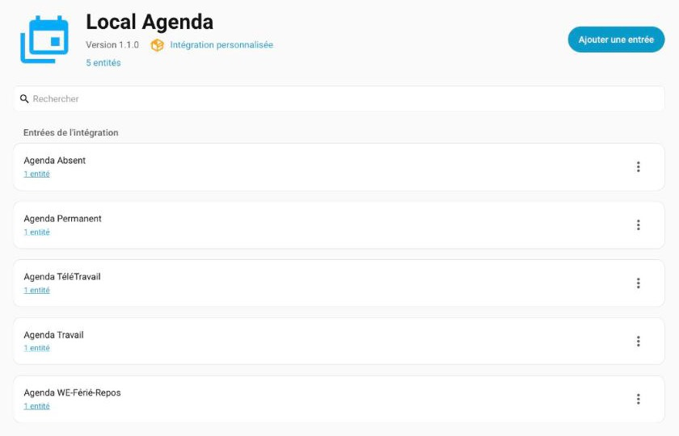
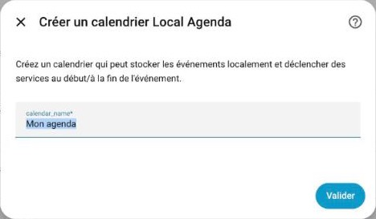
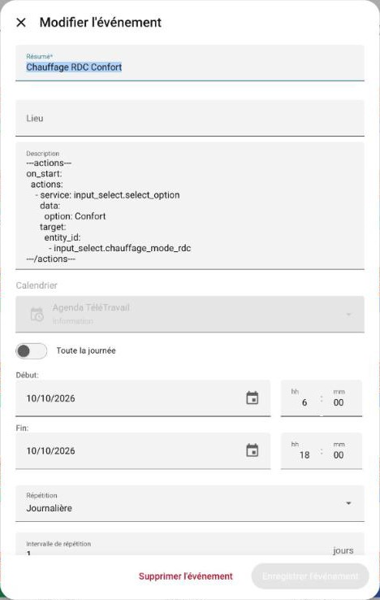

# Local Agenda

[![GitHub Release][releases-shield]][releases]
[](https://github.com/hacs/integration)
[](#)

🇬🇧 [English version](README_en.md) · 📖 [Wiki du projet](https://github.com/slemeur91/local_agenda/wiki)

Un composant personnalisé pour Home Assistant qui étend l'intégration `local_calendar` en ajoutant la possibilité de déclencher des services Home Assistant au début et/ou à la fin d'événements.

---

## Origine et conception

Cette intégration est née d'un **mixte entre deux approches** :

- **L'intégration `local_calendar` de Home Assistant** : elle fournit le socle de gestion des événements, le stockage ICS et l'interface calendrier native dans HA.
- **L'approche de Jeedom** : sur Jeedom, c'est l'événement lui-même qui porte et déclenche les actions. Ce principe a été transposé ici — chaque événement du calendrier embarque dans sa description le bloc YAML qui définit ce qu'il faut faire au démarrage et à l'arrêt.

### Problèmes rencontrés avec l'intégration native HA et solutions apportées

L'intégration calendrier native de Home Assistant utilise des **événements HA** (bus d'événements) pour déclencher les actions. Cette approche présente deux défauts critiques dans les cas réels :

1. **Événements croisés** : si l'événement A démarre, puis l'événement B démarre, puis A s'arrête, puis B s'arrête — les événements HA se mélangent et les déclenchements sont incorrects ou manqués.
2. **Événements proches** : lorsque la fin d'un événement et le début du suivant sont très rapprochés dans le temps, les transitions sont ratées ou doublées.

**Solution retenue** : Local Agenda n'utilise **pas** le bus d'événements HA. À la place, un **scheduleur interne interroge toutes les 20 secondes** (`async_track_time_interval`) la liste des événements dans une fenêtre glissante de ±22 secondes autour du moment présent. Chaque déclenchement est protégé par une **clé de déduplication unique** composée de l'`entry_id`, de l'`uid` de l'événement et de l'horodatage ISO de début ou de fin :

```
start_key = "{entry_id}:{uid}:{start_iso}:start"
stop_key  = "{entry_id}:{uid}:{end_iso}:stop"
```

Cette clé garantit qu'une même action n'est jamais déclenchée deux fois, même avec des événements croisés ou très proches. Les événements récurrents sont également correctement gérés : l'horodatage de l'occurrence est inclus dans la clé, de sorte que chaque occurrence d'un même événement récurrent obtient son propre ticket.

---

## Cas d'usage : gestion du chauffage

L'usage principal pour lequel cette intégration a été conçue est la **gestion du chauffage** de deux zones indépendantes (Rez-de-chaussée et Étage), avec des horaires différents selon le type de journée.

Cinq agendas suffisent : **Travail**, **TéléTravail**, **WE-Férié-Repos**, **Absent** et **Permanent**. Un seul agenda de type journée est actif à la fois ; les actions des agendas dont l'entité est désactivée sont ignorées.



Venant de Jeedom, il m'avait fallu 12 agendas et 7 automatisations pour obtenir le même résultat avec le calendrier natif. Le détail est dans le wiki : [Pourquoi cette intégration ?](https://github.com/slemeur91/local_agenda/wiki/Pourquoi-cette-integration) et [Cas d'usage : le chauffage](https://github.com/slemeur91/local_agenda/wiki/Cas-d-usage-chauffage).

---

## Installation

### HACS

[](https://my.home-assistant.io/redirect/hacs_repository/?owner=slemeur91&repository=local_agenda&category=integration)

### Manuellement

1. Copiez le dossier `local_agenda` dans `config/custom_components/` de votre installation Home Assistant.
2. Redémarrez Home Assistant.
3. **Paramètres → Appareils et services → Ajouter une intégration → Local Agenda**.

Home Assistant 2026.4.0 ou plus récent est requis.

---

## Prise en main

### 1. Créer un agenda

Dans **Paramètres → Appareils et services**, ajoutez l'intégration **Local Agenda** et donnez un nom à l'agenda. Répétez l'opération pour chaque agenda.



### 2. Créer un événement

Dans la vue **Calendrier** de Home Assistant, créez un événement dans votre agenda, avec des heures précises et une récurrence si besoin.

### 3. Ajouter les actions dans la description

Le bloc `---actions---` de la description indique quoi faire au début (`on_start`) et à la fin (`on_stop`) de l'événement. Les deux sont facultatifs.

```
Session d'arrosage de la pelouse

---actions---
on_start:
  actions:
    - service: switch.turn_on
      target:
        entity_id: switch.arrosage_pelouse
on_stop:
  actions:
    - service: switch.turn_off
      target:
        entity_id: switch.arrosage_pelouse
---/actions---
```

Une phase peut être soumise à des conditions (`state`, `or`, `and`, `not`) :

```
---actions---
on_start:
  conditions:
    - condition: state
      entity_id: input_select.calendrier
      state:
        - Travail
        - TéléTravail
  actions:
    - service: input_select.select_option
      data:
        option: Confort
      target:
        entity_id: input_select.chauffage_mode_rdc
---/actions---
```



La syntaxe complète est décrite dans le wiki : [Syntaxe des actions](https://github.com/slemeur91/local_agenda/wiki/Syntaxe-des-actions), [Conditions](https://github.com/slemeur91/local_agenda/wiki/Conditions) et [Exemples](https://github.com/slemeur91/local_agenda/wiki/Exemples).

---

## Panneau Local Agenda

Une entrée **Local Agenda** s'ajoute à la barre latérale de Home Assistant. Ce panneau permet de modifier les conditions et les appels de service d'un événement avec un formulaire, sans écrire le YAML à la main. Les badges **remplie / non remplie** indiquent en direct si une condition est satisfaite.


> ⚠️ Ce panneau est récent et n'a pas encore été complètement éprouvé. La méthode de référence reste la saisie du bloc YAML dans la description de l'événement.

Voir [Panneau Local Agenda](https://github.com/slemeur91/local_agenda/wiki/Panneau-Local-Agenda) dans le wiki.

---

## Limitations

- Les actions partent avec une précision d'une vingtaine de secondes.
- Si Home Assistant est arrêté lors d'un début ou d'une fin d'événement, l'action n'est pas rattrapée.
- La déduplication est en mémoire : une action peut être rejouée si Home Assistant redémarre juste après une transition.
- Les événements doivent avoir des heures précises, pas « toute la journée ».
- Seules les conditions `state`, `or`, `and` et `not` sont prises en charge.

La liste complète est dans [Limitations](https://github.com/slemeur91/local_agenda/wiki/Limitations).

---

## Logs et diagnostic

Les actions déclenchées sont journalisées au niveau **INFO** :

```
local_agenda: [start] 'Chauffage RDC Confort - Matin' → input_select.select_option
```

Les erreurs d'appel de service sont journalisées au niveau **ERROR** mais n'interrompent pas la boucle — les autres actions de l'événement continuent de s'exécuter.

Les conditions non satisfaites sont journalisées au niveau **DEBUG** :

```
local_agenda: condition not met for 'Chauffage RDC Confort - Matin' [start] — skipping
```

Pour activer les logs de débogage, ajoutez dans `configuration.yaml` :

```yaml
logger:
  logs:
    custom_components.local_agenda: debug
```

---

## Documentation

| Sujet | Page du wiki |
|---|---|
| Créer un agenda, créer et modifier des événements | [Créer un agenda](https://github.com/slemeur91/local_agenda/wiki/Creer-un-agenda) · [Événements](https://github.com/slemeur91/local_agenda/wiki/Creer-et-modifier-des-evenements) |
| Écrire les actions et les conditions | [Syntaxe des actions](https://github.com/slemeur91/local_agenda/wiki/Syntaxe-des-actions) · [Conditions](https://github.com/slemeur91/local_agenda/wiki/Conditions) · [Exemples](https://github.com/slemeur91/local_agenda/wiki/Exemples) |
| Scheduleur, stockage, API WebSocket | [Fonctionnement interne](https://github.com/slemeur91/local_agenda/wiki/Fonctionnement-interne) |
| Une action ne se déclenche pas, activer les logs | [Dépannage et logs](https://github.com/slemeur91/local_agenda/wiki/Depannage-et-logs) |

Historique des versions : [CHANGELOG.md](CHANGELOG.md).

---

[releases-shield]: https://img.shields.io/github/release/slemeur91/local_agenda.svg?style=flat-square
[releases]: https://github.com/slemeur91/local_agenda/releases
