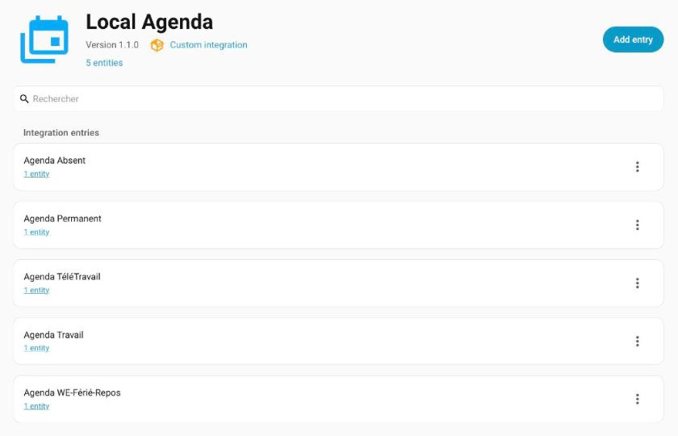
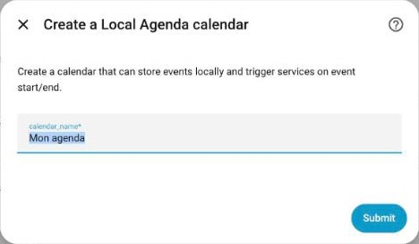
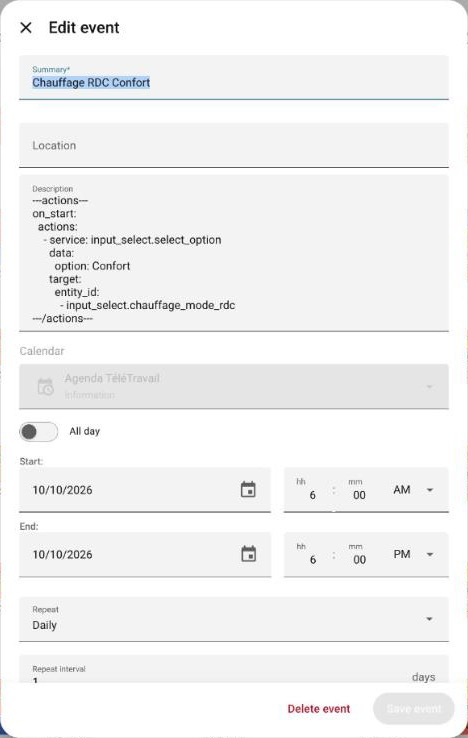
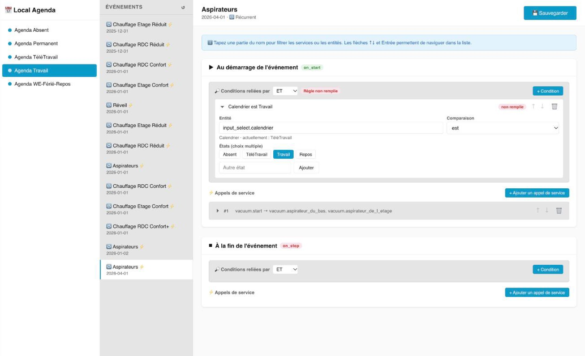

# Local Agenda

[![GitHub Release][releases-shield]][releases]
[](https://github.com/hacs/integration)
[](#)

🇫🇷 [Version française](README.md) · 📖 [Project wiki](https://github.com/slemeur91/local_agenda/wiki) (in French)

A custom component for Home Assistant that extends the `local_calendar` integration with the ability to call Home Assistant services at the start and/or end of calendar events.

---

## Origin and design

This integration is a **blend of two approaches**:

- **Home Assistant's `local_calendar` integration**: it provides the foundation for event management, ICS storage and the native calendar interface.
- **The Jeedom approach**: in Jeedom, the event itself carries and triggers its actions. That principle is transposed here — each calendar event embeds, in its description, the YAML block that defines what to do when it starts and when it ends.

### Problems met with the native integration, and how they are solved

Home Assistant's native calendar integration relies on **HA events** (the event bus) to trigger actions. In real-life setups this showed two critical flaws:

1. **Overlapping events**: if event A starts, then event B starts, then A ends, then B ends, the HA events get mixed up and triggers are wrong or missed.
2. **Back-to-back events**: when the end of one event and the start of the next are very close in time, transitions are missed or fired twice.

**The chosen solution**: Local Agenda does **not** use the HA event bus. Instead, an **internal scheduler polls every 20 seconds** (`async_track_time_interval`) the events found in a sliding window of ±22 seconds around the current time. Each trigger is protected by a **unique deduplication key** made of the `entry_id`, the event `uid` and the ISO timestamp of its start or end:

```
start_key = "{entry_id}:{uid}:{start_iso}:start"
stop_key  = "{entry_id}:{uid}:{end_iso}:stop"
```

This key guarantees that an action is never fired twice, even with overlapping or back-to-back events. Recurring events are handled correctly too: the timestamp of the occurrence is part of the key, so each occurrence of a recurring event gets its own ticket.

---

## Use case: heating schedules

The integration was primarily designed for **heating management** across two independent zones (ground floor and first floor), with schedules that depend on the type of day.

Five calendars are enough: **Travail** (office day), **TéléTravail** (working from home), **WE-Férié-Repos** (weekends, public holidays, days off), **Absent** (away) and **Permanent** (always on). Only one day-type calendar is active at a time; actions from calendars whose entity is disabled are ignored.



Coming from Jeedom, I needed 12 calendars and 7 automations to get the same result with the native calendar. Local Agenda brought that back to 5 calendars and no automation.

---

## Installation

### HACS

[](https://my.home-assistant.io/redirect/hacs_repository/?owner=slemeur91&repository=local_agenda&category=integration)

### Manual

1. Copy the `local_agenda` folder into `config/custom_components/` of your Home Assistant installation.
2. Restart Home Assistant.
3. **Settings → Devices & services → Add integration → Local Agenda**.

Home Assistant 2026.4.0 or newer is required.

---

## Getting started

### 1. Create a calendar

In **Settings → Devices & services**, add the **Local Agenda** integration and give the calendar a name. Repeat for each calendar you need.



### 2. Create an event

In Home Assistant's **Calendar** view, create an event in your calendar, with specific start and end times and a recurrence if needed.

### 3. Add the actions to the description

The `---actions---` block in the description says what to do at the start (`on_start`) and at the end (`on_stop`) of the event. Both are optional.

```
Lawn watering session

---actions---
on_start:
  actions:
    - service: switch.turn_on
      target:
        entity_id: switch.lawn_watering
on_stop:
  actions:
    - service: switch.turn_off
      target:
        entity_id: switch.lawn_watering
---/actions---
```

Each service call accepts:

| Field | Required | Description |
|---|---|---|
| `service` | Yes | `domain.service` format, e.g. `switch.turn_on`. |
| `target` | No | Target of the call, usually `entity_id` (one entity or a list). |
| `data` | No | Service parameters, e.g. `option: Comfort`. |
| `entity_id` | No | Shorthand for `target: {entity_id: ...}`. |

A phase can be subject to conditions, evaluated when the event starts or ends:

```
---actions---
on_start:
  conditions:
    - condition: state
      entity_id: input_select.day_type
      state:
        - Office
        - Home
  actions:
    - service: input_select.select_option
      data:
        option: Comfort
      target:
        entity_id: input_select.heating_mode_ground_floor
---/actions---
```

| Condition | True when |
|---|---|
| `state` | The entity state matches the expected value, or one of the listed values. |
| `or` | At least one sub-condition is true. |
| `and` | All sub-conditions are true. This is the default between conditions listed at the top level. |
| `not` | None of the sub-conditions is true. |

Quote values that YAML would read as something other than text: write `state: "on"`, not `state: on`. A condition of an unknown type is treated as not met: it blocks execution and a warning is logged.



---

## Local Agenda panel

A **Local Agenda** entry is added to the Home Assistant sidebar. This panel lets you edit the conditions and service calls of an event through a form, without writing YAML by hand. Live badges show whether each condition is currently met.



The panel interface is currently available in French only.

> ⚠️ This panel is recent and has not been fully battle-tested yet. Typing the YAML block in the event description remains the reference method.

---

## Limitations

- Actions fire with a precision of about twenty seconds.
- If Home Assistant is down when an event starts or ends, the action is not replayed afterwards.
- Deduplication is in memory: an action may fire again if Home Assistant restarts right after a transition.
- Events must have specific times, not "all day".
- Only `state`, `or`, `and` and `not` conditions are supported.
- Jinja templates are not rendered in action data.

---

## Logs and troubleshooting

Triggered actions are logged at **INFO** level:

```
local_agenda: [start] 'Heating ground floor comfort' → input_select.select_option
```

Unmet conditions are logged at **DEBUG** level, and failed service calls at **ERROR** level without stopping the remaining actions. To enable debug logs, add this to `configuration.yaml`:

```yaml
logger:
  logs:
    custom_components.local_agenda: debug
```

---

## Documentation

The [project wiki](https://github.com/slemeur91/local_agenda/wiki) covers every topic in depth. It is written in French.

Release history: [CHANGELOG.md](CHANGELOG.md) (in French).

---

[releases-shield]: https://img.shields.io/github/release/slemeur91/local_agenda.svg?style=flat-square
[releases]: https://github.com/slemeur91/local_agenda/releases
